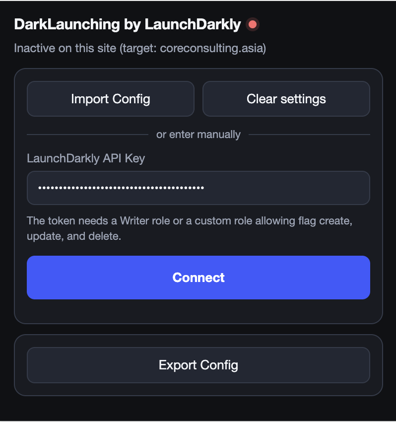
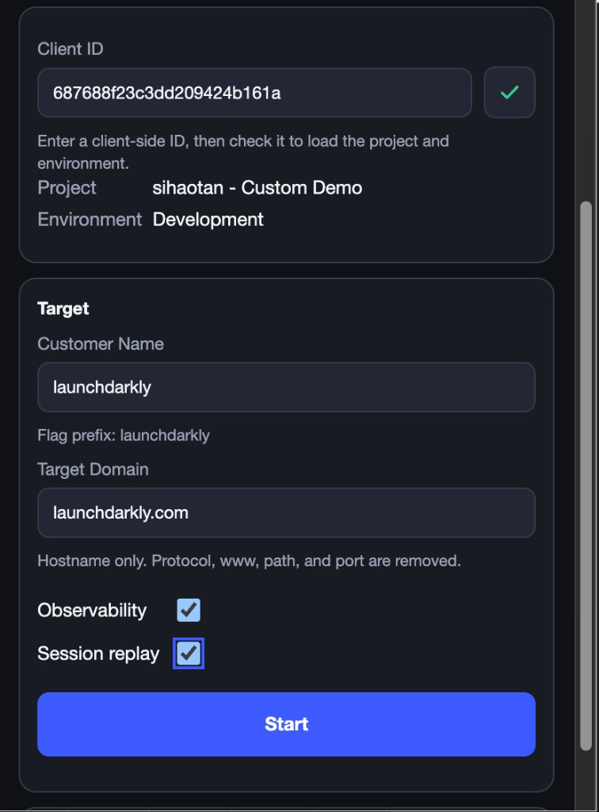
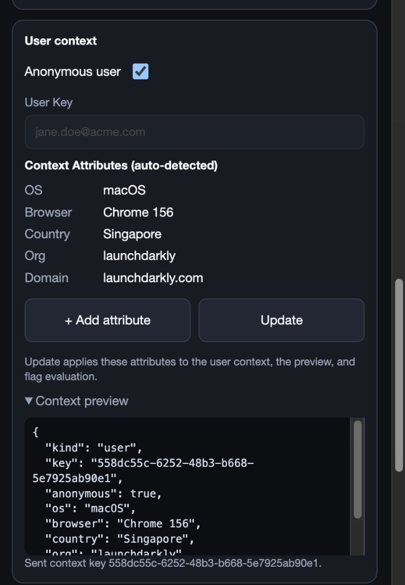
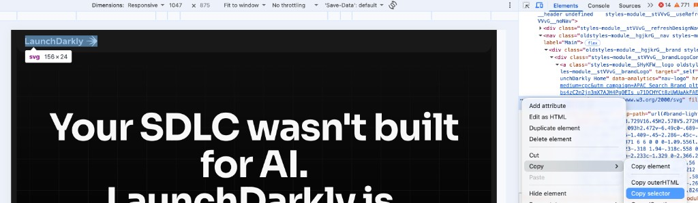
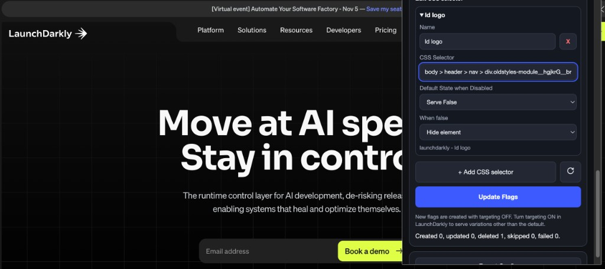
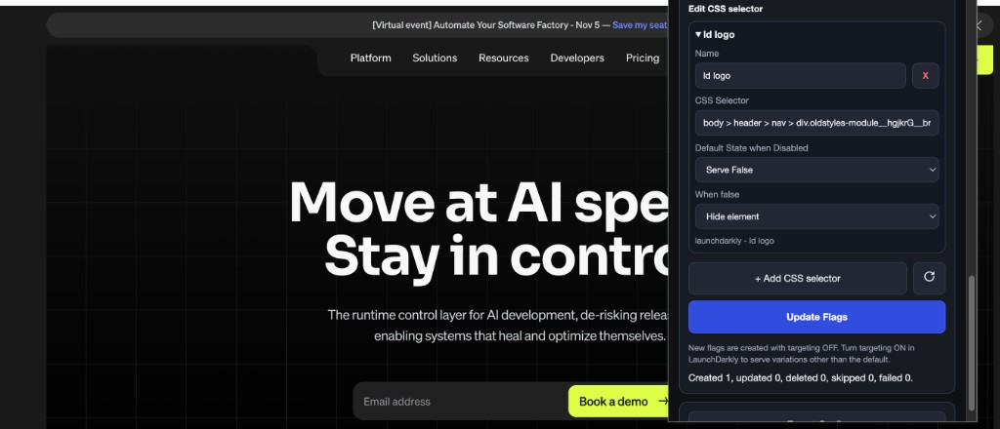
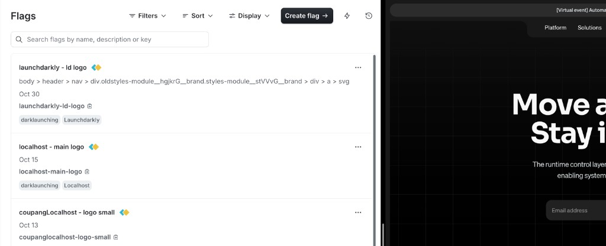
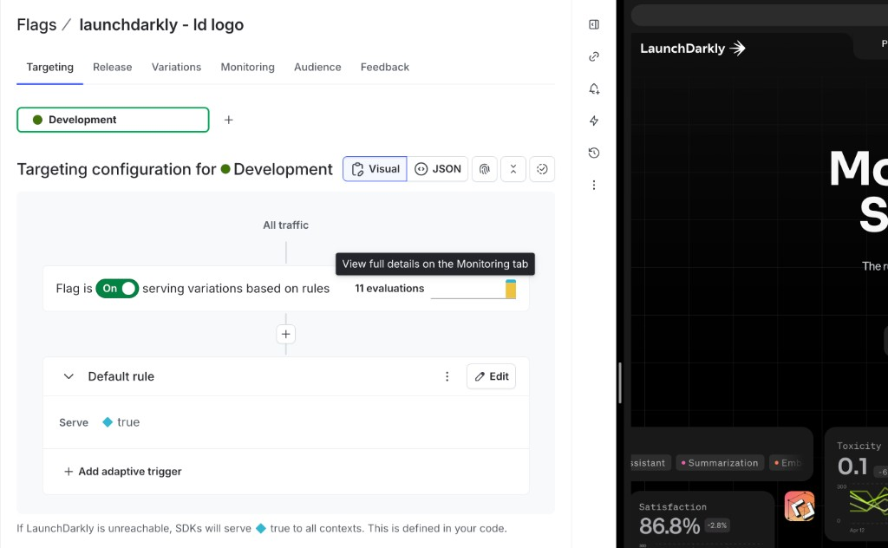

# DarkLaunching

Chrome extension that manages LaunchDarkly flags for DOM elements on a target domain.

## Install in Chrome

DarkLaunching is loaded as an unpacked Manifest V3 extension. Chrome requires **Developer mode** for that.

### Download

1. Open the repository: [https://github.com/sihaotan/darklaunching](https://github.com/sihaotan/darklaunching).
2. Click **Code → Download ZIP**, then unzip the file.
3. Or clone it:

```bash
git clone https://github.com/sihaotan/darklaunching.git
cd darklaunching
```

The loadable extension is in the `dist/` folder. If you change source files, rebuild first:

```bash
npm install
npm run build
```

### Add the extension

1. Open Chrome and go to `chrome://extensions`.
2. Turn on **Developer mode** in the top-right corner.
3. Click **Load unpacked**.
4. Select the `dist` folder inside this project (the folder that contains `manifest.json`).
5. Pin **DarkLaunching by LaunchDarkly** from the Extensions menu if you want the toolbar icon.

After you change the source and run `npm run build`, return to `chrome://extensions` and click **Reload** on the DarkLaunching card. Reload the target page if content-script or telemetry behavior changed.

To remove it later, open `chrome://extensions`, find DarkLaunching, and click **Remove**.

## API access token

Create a token under **Organization settings → Authorization → Access tokens**, then paste it into the extension’s LaunchDarkly API Key field. This is the account API token, not an environment SDK key or client-side ID.

A **Writer** role is enough. A Reader token can connect and list projects, but **Update Flags** will fail with a permissions error.

If your plan includes custom roles, choose **Inline policy** and use this policy instead of Writer. It covers the calls this extension makes: list projects and environments, list flags, create a flag, change its off variation, update its tags, and delete a flag.

```json
[
  {
    "effect": "allow",
    "actions": ["viewProject"],
    "resources": ["proj/*"]
  },
  {
    "effect": "allow",
    "actions": ["createFlag", "deleteFlag", "updateOffVariation", "updateTags"],
    "resources": ["proj/*:env/*:flag/*"]
  }
]
```

Replace `proj/*` with a project key, such as `proj/default`, if this token should only manage one project. Keep `:env/*` so every environment in the popup still works.

If creating a flag returns a 403, add `updateClientSideFlagAvailability`, `updateTags`, and `updateFlagDefaultVariations` to that second actions list. The extension sets client-side availability, ownership tags, and the off variation when it creates a flag.

## Architecture

DarkLaunching is a Manifest V3 extension with three parts. Only the first two can see the LaunchDarkly API key.

| Part | Where it runs | What it holds |
| --- | --- | --- |
| Popup | Extension page opened from the toolbar | Configuration UI, including the API key field |
| Service worker | Extension background | LaunchDarkly REST calls, host permissions, content-script registration |
| Content script | The target domain only, after you allow site access | Client-side SDK, DOM changes, and the user context |

The content script is injected only for the target domain you grant. It evaluates flags with the environment **client-side ID**. It does not call `https://app.launchdarkly.com` and it does not receive the API key.

## Data flow

1. You enter the API key in the popup. The popup stores it in extension-only storage and sends Connect, Refresh, and Update Flags as messages that do not include the key.
2. The service worker reads the key itself and calls the LaunchDarkly REST API. The `Authorization` header is attached only to requests whose origin is `https://app.launchdarkly.com`.
3. Connect saves the customer, target domain, project, environment, client-side ID, selectors, and user context. That saved record has no API key.
4. The service worker registers the content script for the granted target host. On that page, the script starts `@launchdarkly/js-client-sdk` with the client-side ID and the user context (`anonymous`, `os`, `browser`, `country`, `org`, `domain`, and any extra attributes).
5. Flag evaluation and DOM changes stay in the content script. Create, update, and delete flag calls stay in the service worker.
6. Analytics events from the page are relayed through the service worker to `https://events.launchdarkly.com`. The relay carries the client-side ID and the context. It does not carry the API key.

## Security

The LaunchDarkly API key stays inside DarkLaunching. It is not loaded into the target domain.

- The content script source and its built bundle do not contain the API key or `app.launchdarkly.com`.
- Messages sent to the target tab are limited to identify, reconfigure, and shutdown. None of them include the API key.
- The key is stored in `chrome.storage.session` with access level `TRUSTED_CONTEXTS`, so a content script cannot read it, and in IndexedDB on the extension origin (`chrome-extension://…`). A content script’s IndexedDB is the target page’s origin, not the extension’s.
- Any older copy under `chrome.storage.local` is removed. Content scripts can read that storage area, so the key is not left there.
- The target page receives the client-side ID only. That ID is what the client-side SDK uses to evaluate flags.

Export Config downloads a JSON file from the popup. That file contains the API key in plain text so you can import the configuration later. The download is not sent to the target domain.

## How to use DarkLaunching on a live domain

This walkthrough shows how to use DarkLaunching for a feature, targeting, and observability demo on a live website. Install the extension first (see [Install in Chrome](#install-in-chrome)), then create an API access token (see [API access token](#api-access-token)).

Open the live site you want to demo in Chrome, then open the DarkLaunching popup from the toolbar.

### 1. Connect with your LaunchDarkly API key

1. Paste your LaunchDarkly API access token into **LaunchDarkly API Key**.
2. Click **Connect**.
3. Chrome may ask for site access later when you set the target domain. Allow the host you will demo.



Connect only validates that the API key can talk to LaunchDarkly. Customer name, target domain, Observability, and Session replay come next.

### 2. Choose the Client ID, then set the target

1. Paste the environment **Client ID** from LaunchDarkly (**Project settings → Environments**).
2. Click the green check mark beside the field.
3. DarkLaunching fills in the matching **Project** and **Environment**.
4. Enter a **Customer Name**. This becomes the flag name prefix and the `org` context attribute.
5. Enter the **Target Domain** as a hostname only, such as `launchdarkly.com`.
6. Turn on **Observability** and/or **Session replay** when those are part of the demo.
7. Click **Start**.



Start locks the Client ID, customer name, target domain, and telemetry checkboxes. It also shows **User context** and **Edit CSS selector**. Click **Stop** when you need to change the domain or turn telemetry off.

If the popup says the extension is inactive on this site, open a tab on the target hostname and allow site access when Chrome asks.

### 3. Confirm the user context for targeting

After **Start**, review **User context**. This is the context DarkLaunching sends for flag evaluation, Observability, and Session replay.

1. Leave **Anonymous user** checked for a generated key, or clear it and enter a stable **User Key**.
2. Check the auto-detected attributes: OS, browser, country, org (customer name), and domain (target domain).
3. Use **+ Add attribute** for custom attributes when the demo needs them.
4. Click **Update**, then open **Context preview** to confirm the JSON LaunchDarkly will receive.



In LaunchDarkly, open **Contexts** for that environment to show the same key and attributes during the demo.

### 4. Copy a CSS selector from the live page

1. On the live site, right-click the element you want to control and choose **Inspect**.
2. In DevTools, right-click the highlighted node.
3. Choose **Copy → Copy selector**.



### 5. Add the selector in DarkLaunching

1. In **Edit CSS selector**, click **+ Add CSS selector**.
2. Enter a short **Name**, such as `ld logo`.
3. Paste the selector into **CSS Selector**.
4. Set **Default State when Disabled** (usually **Serve False**).
5. Set **When false** to **Hide element** or **Show element**.
6. Click **Update Flags**.





DarkLaunching creates a boolean flag named `{customer name} - {name}`, tags it with `darklaunching` and the customer tag, and stores the CSS selector in the flag **description**. New flags are created with targeting off. Use the refresh icon next to **+ Add CSS selector** to pull existing DarkLaunching flags for this customer and apply their selectors again.

### 6. Show the flag in LaunchDarkly

Open the project and environment you selected with the Client ID. The new flag appears with the CSS selector in the description and the `darklaunching` tag.



### 7. Turn targeting on for the feature demo

1. Open the flag and go to the **Targeting** tab for that environment.
2. Turn the flag **On**.
3. Set the default rule to **Serve: true** or **Serve: false**, or add rules that match the user context from step 3.
4. Watch the live page. When the served variation is false and **When false** is **Hide element**, the selected DOM node is hidden. When it is true, the node is restored.
5. Point to **Evaluations** on the Targeting or Monitoring tab to show flag traffic from the live page.



### 8. Observability and Session replay demo

When **Observability** and **Session replay** were checked before **Start**:

1. Browse and click through the live target domain while collection is running.
2. In LaunchDarkly, open **Observability** for errors, performance, and related telemetry for that Client ID and environment.
3. Open **Session replay** to find sessions for the context key shown in DarkLaunching’s context preview.
4. Click **Stop** in DarkLaunching when the demo should stop sending Observability and Session replay data. Flag evaluation for CSS selectors continues until you disconnect or leave the target site.

### Demo checklist

| Goal | What to show |
| --- | --- |
| Feature control | CSS selector flag on a live element; toggle true/false in LaunchDarkly and watch the page |
| Targeting | Anonymous or named context, custom attributes, and a targeting rule that matches that context |
| Observability | Observability and Session replay checked before Start; live session and telemetry for the same context |

### Tips

- Use a hostname that matches the live tab. Subdomains of the target apex are included when you grant access.
- After source changes, rebuild with `npm run build`, reload the extension on `chrome://extensions`, and reload the target page.
- **Export Config** saves a JSON file that includes the API key. Store that file securely.
- **Clear settings** can keep the API key and Client ID, or clear everything.
